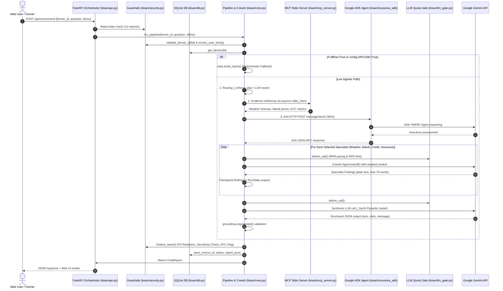

# Phase 0: OCI Deployment Readiness Audit Report
**Project:** Kisan Copilot  
**Target Environment:** Oracle Cloud Infrastructure (OCI) Always Free — Ubuntu Linux (ARM64 / Ampere A1), 2 OCPUs, 12 GB RAM  
**Audit Date:** 2026-11-25  
**Auditor Status:** Senior Agentic AI Systems Architect  
**Objective:** Complete pre-deployment readiness inspection to ensure genuine live agentic execution (CrewAI specialists, Google ADK insurance agent over A2A, MCP stdio tools, structured Pydantic outputs, guardrails, and HITL) with zero silent offline fallbacks.

---

## 1. Executive Summary

A comprehensive, read-only audit of the Kisan Copilot repository was performed directly against the WSL2 Ubuntu 22.04 environment, inspecting actual source code, test execution, dependency graphs, process architectures, and protocol boundaries.

### Key Audit Findings:
1. **The Core Agentic Architecture is Real, Functional, and 100% Tested Locally:**  
   The test suite executes with **98 passed unit/component tests in 19.56s**. Pure offline unit testing verifies schema validation, guardrails, policy routing, MCP stdio tool dispatch, A2A data parsing, and state sharing.
2. **The Render Deployment Failure Root Cause:**  
   The existing deployment at `https://kisan-copilot.onrender.com` runs in offline mode because `Dockerfile.render` explicitly forces `ENV OFFLINE=1` and installs only `requirements-cloud.txt` (FastAPI + Pydantic + Uvicorn), omitting `crewai`, `google-adk`, `litellm`, and `mcp`. This was done as a band-aid to fit Render's 512 MB free tier memory cap.
3. **OCI Always Free Fit (Ampere A1 ARM64 / 2 OCPUs / 12 GB RAM):**  
   The target OCI infrastructure is exceptionally well-suited. The full dual-service architecture (FastAPI/CrewAI + ADK A2A service + MCP subprocesses) requires approximately **1.2 GB to 1.8 GB RAM** in normal operation and peaks around **2.5 GB to 3.5 GB RAM**. The 12 GB RAM allocation provides ample headroom (~8–9 GB free), completely eliminating memory-induced OOM crashes.
4. **All Python Dependencies Support Linux ARM64:**  
   Critical native packages (`pydantic-core`, `tiktoken`, `tokenizers`, `onnxruntime`, `grpcio`, `uvloop`, `cryptography`, `pyarrow`) have pre-compiled manylinux `aarch64` wheels on PyPI for Python 3.11.
5. **Critical Live Execution Blockers Identified:**  
   Five specific code/configuration hazards were uncovered that would prevent live execution or cause immediate quota/startup failures on OCI if unaddressed:
   - **Database Seed Data Loss on Restart:** `db.seed()` executed in `start.sh` runs `DELETE FROM farmers`, resetting farmer records on every service launch.
   - **Missing Reverse Proxy Header Handling:** `kisan/api.py` uses `request.client.host` for rate limiting without proxy header middleware; behind Nginx/Caddy, all incoming requests would share `127.0.0.1` and quickly trigger false 429 throttles.
   - **Silent API Key Absence:** If `API_KEY` is not set in `.env`, the FastAPI auth dependency is a no-op, exposing the recommendation endpoint to unauthenticated external access.
   - **Process Supervision Defect in `start.sh`:** `start.sh` launches ADK as a background process with `&` and a trap on script exit, but does not monitor ADK health during long runtime; if the ADK process dies, requests degrade silently.
   - **Dual Virtual Environments Are Mandatory:** Dependency version conflicts exist between `crewai` and `google-adk` (notably conflicting pins of `litellm` and OpenTelemetry instrumentors). The dual venv architecture (`.venv-crew` and `.venv-adk`) is structurally necessary and must be preserved on the VM or multi-service container setup.

---

## 2. Actual Repository Architecture

### 2.1 Inventory of Python Source Files & Modules

| Module Path | Runtime Role | Active Framework / Technology |
|---|---|---|
| `kisan/__init__.py` | Package root initialization | Pure Python |
| `kisan/config.py` | Central environment parsing, quota limits, model aliases | `python-dotenv`, `pydantic` |
| `kisan/schemas.py` | Domain schemas, Pydantic outputs, shared `RunState` | `pydantic.BaseModel` |
| `kisan/db.py` | SQLite persistence, farmer queries, run logs, reviews | `sqlite3` (context managers) |
| `kisan/core_tools.py` | Weather (Open-Meteo), Mandi (AgMarkNet), Credit (KCC), PMFBY calculation | `httpx`, pure business logic |
| `kisan/mandi_refresh.py` | Offline CLI cache refresher for data.gov.in mandi records | `httpx`, file I/O |
| `kisan/mcp_server.py` | FastMCP stdio server exposing weather, mandi, and credit tools | `mcp.server.fastmcp.FastMCP` |
| `kisan/insurance_adk/agent.py` | Crop Insurance agent with tool callback guardrails | `google-adk`, `google-genai` |
| `kisan/a2a_client.py` | A2A JSON-RPC client invoking ADK agent via `message/send` | `httpx`, `crewai.tools.tool` |
| `kisan/security.py` | Multi-stage guardrails: injection patterns, PII redaction, HITL | `re`, `unicodedata`, thread-safe rate limiter |
| `kisan/grounding.py` | Numeric grounding validator ensuring no hallucinated figures | `re`, set operations |
| `kisan/rules.py` | Deterministic fallback and offline baseline generator | Pure Python domain rules |
| `kisan/observability.py` | JSONL run audit logging and optional Langfuse tracing | OpenInference / Langfuse v3 |
| `kisan/llm_gate.py` | Daily budget (RPD) & pacing (RPM) rate gate | File-backed thread-safe lock |
| `kisan/crew.py` | Orchestration pipeline, policy router, checkpointed execution, synthesis | `crewai.Crew`, `Agent`, `Task`, `LLM` |
| `kisan/api.py` | Web service endpoints, run review, dashboard host | `fastapi.FastAPI`, `starlette` |
| `kisan/evaluate.py` | Benchmark evaluation harness: agentic vs rule baseline | `httpx`, statistical evaluation |
| `kisan/cli.py` | CLI commands (`seed`, `run`, `eval`) | `argparse` |

### 2.2 UI and Static Assets
- `kisan/static/index.html`: Fully self-contained single-page dashboard containing CSS styling, agent flow state visualization, live JSONL polling (`/api/latest-events`), review approval controls, and responsive layout. No external CDNs or remote JS dependencies (only a standard WhatsApp web link `wa.me`).

### 2.3 Dockerfiles, Scripts & Environment Files
- `Dockerfile`: Multi-venv container specification building `/opt/venv-crew` and `/opt/venv-adk` based on `python:3.11-slim`.
- `Dockerfile.render`: Lightweight offline build created for Render 512 MB tier (`OFFLINE=1`). **Must NOT be used on OCI.**
- `start.sh`: Production startup script; seeds database, launches ADK agent on `127.0.0.1:8001`, polls readiness, and starts FastAPI.
- `start-cloud.sh`: Render startup script (FastAPI only, no ADK).
- `requirements.txt`: Core dependencies for CrewAI environment (`crewai[litellm,google-genai]`, `mcp`, `fastapi`, `json-repair`).
- `requirements-adk.txt`: Dependencies for Google ADK environment (`google-adk[a2a]`, `litellm`, `google-genai`).
- `requirements-obs.txt` & `requirements-obs-adk.txt`: Optional Langfuse / OpenTelemetry instrumentation packages.
- `requirements-cloud.txt`: Render-specific trimmed list.
- `.env`: Local secrets and configuration file (untracked in git, verified non-leaking).
- `.env.example`: Safe configuration template with zero exposed secrets.

### 2.4 Test Suite Inventory
- 18 test modules in `tests/` comprising **98 passing unit and integration tests**:
  `test_a2a.py`, `test_core_tools.py`, `test_crew_logic.py`, `test_db.py`, `test_demo_mode.py`, `test_evaluate.py`, `test_events_api.py`, `test_grounding.py`, `test_latest_events.py`, `test_llm_gate.py`, `test_mandi_snapshot.py`, `test_mcp.py`, `test_pipeline_offline.py`, `test_rules.py`, `test_schemas.py`, `test_security.py`, `test_static_ui.py`.

### 2.5 Runtime Artifacts That Must NOT Be Committed
- `data/kisan.db` (SQLite state)
- `data/mandi_snapshot.json` (cached prices)
- `logs/*.jsonl` (run event logs)
- `logs/eval_report.md` & `logs/eval_results.json` (benchmark runs)
- `logs/quota_*.json` (daily call counters)
- `.pytest_cache/`, `__pycache__/`

---

## 3. Verified Execution Flow (End-to-End)



### Stage-by-Stage Verification & Fallback Triggers

| Stage | Exact Code Location | Logic & Behavior | Fallback Triggers |
|---|---|---|---|
| **1. Validation & Input Guardrails** | `kisan/crew.py:303-304`, `kisan/security.py:36,49` | Normalizes ID format (`^F\d{3}$`), filters injection patterns (`_INJ`), blocks abusive language (`_TOXIC`). | Raises `GuardrailViolation` (HTTP 400). Execution terminates immediately; no fallback. |
| **2. Farmer Profile Retrieval** | `kisan/crew.py:305-307`, `kisan/db.py:52-56` | Reads profile from SQLite in read-only mode (`mode=ro`). | If ID not found, raises `LookupError` (HTTP 404). |
| **3. Policy Router & Planning** | `kisan/crew.py:44-53, 195-214` | Weather + Insurance always selected; Credit added if outstanding loan > 0; Mandi added if harvest $\le 60$ days. If question present, invokes Orchestrator LLM. | If LLM router fails or hits quota, logs error and proceeds with deterministic policy router. |
| **4. MCP Stdio Tool Execution** | `kisan/crew.py:124-165`, `kisan/mcp_server.py:28-51` | Spawns `python -m kisan.mcp_server` over stdio with sanitized environment (`PATH`, `HOME`, `DATA_GOV_API_KEY`, `KISAN_DB`). Dispatches 3 tools with 60s timeout. | If tool fails or times out, returns `{"error": ...}` in JSON; pipeline continues. Scans outputs for indirect prompt injection. |
| **5. A2A Protocol Invocation** | `kisan/crew.py:220-229`, `kisan/a2a_client.py:32-71` | Fetches agent card from `http://127.0.0.1:8001/.well-known/agent-card.json`, sends JSON-RPC `message/send` to `/`. | If unreachable or returns error, injects error string into evidence. Insurance specialist degrades gracefully without aborting whole pipeline. |
| **6. Checkpointed Specialists** | `kisan/crew.py:234-257` | Runs single-agent CrewAI task for each domain. Passes previous agents' findings sequentially. Results stored in `RunState.outputs`. | If 1 specialist fails, marked `LLM unavailable` and raw evidence kept. **If $\ge 2$ specialists fail, raises `RuntimeError` and triggers full fallback.** |
| **7. Merged Synthesis & Grounding** | `kisan/crew.py:260-288`, `kisan/grounding.py:18-28` | Generates summary, recommendations, risks, and multilingual messages (Hindi/English/SMS) in ONE structured LLM call. Compares all extracted numbers against tool evidence. | If synthesis produces no valid Pydantic model after 2 attempts, raises `RuntimeError`, triggering rule-based fallback. If numbers ungrounded, adds risk and lowers confidence to $\le 0.45$. |
| **8. Output Guardrails & HITL** | `kisan/security.py:68-92` | Redacts Aadhaar/phone numbers. If financial/credit recommendations exist or confidence $< 0.5$ or mode $\ne$ agentic, sets `status="PENDING_HUMAN_REVIEW"`. | Guarantees compliance; sets disclaimer. |
| **9. Persistence & Audit** | `kisan/crew.py:328-330`, `kisan/db.py:64-68`, `kisan/observability.py:82-96` | Inserts run record into `runs` table, writes event log to `logs/<run_id>.jsonl`. | Always logs terminal event (`final` or `aborted`). |

---

## 4. Live Agentic Blockers (Ranked by Severity)

### Blocker 1: Render-Specific Configuration Enforcing Offline Mode
- **Severity:** **CRITICAL**
- **File Reference:** `Dockerfile.render:2`, `start-cloud.sh:5`, `requirements-cloud.txt:1-5`
- **Evidence:** `Dockerfile.render` specifies `ENV OFFLINE=1` and only installs lightweight packages. `start-cloud.sh` does not launch the ADK insurance service.
- **Impact:** Any deployment using `Dockerfile.render` or `start-cloud.sh` cannot execute live agents.
- **Recommended Minimal Fix:** For OCI, utilize the multi-venv configuration (`Dockerfile` or systemd native services) that installs full `requirements.txt` and `requirements-adk.txt`, launches both services, and sets `OFFLINE=0`.

---

### Blocker 2: Database Re-Seeding Destroys Dynamic Production State
- **Severity:** **HIGH**
- **File Reference:** `kisan/db.py:101-103`, `start.sh:11`
- **Evidence:** 
  ```python
  c.executescript(SCHEMA)
  c.execute("DELETE FROM farmers")
  c.executemany("INSERT INTO farmers VALUES(?,?,?,?,?,?,?,?,?,?,?,?,?,?,?,?,?,?)", rows)
  ```
  `start.sh` executes `python -m kisan.cli seed` on every startup.
- **Impact:** In a persistent environment, container restart or service reboot will wipe any changes to the `farmers` table.
- **Recommended Minimal Fix:** Modify `start.sh` to only seed if the database does not exist (`[ -f data/kisan.db ] || python -m kisan.cli seed`), or update `db.seed()` to insert with `INSERT OR IGNORE`.

---

### Blocker 3: Rate Limiting Breaks Behind Reverse Proxy (IP Collision)
- **Severity:** **HIGH**
- **File Reference:** `kisan/api.py:48-49`, `kisan/security.py:94-109`
- **Evidence:** 
  ```python
  if not limiter.allow(request.client.host if request.client else "anon"):
      raise HTTPException(429, "too many requests")
  ```
- **Impact:** When deployed behind Nginx, Caddy, or Cloudflare, `request.client.host` is always `127.0.0.1` unless Uvicorn is launched with `--proxy-headers --forwarded-allow-ips='*'`. All users globally would share a single 12 req/min bucket, causing immediate false 429 errors.
- **Recommended Minimal Fix:** Add `--proxy-headers --forwarded-allow-ips='*'` to the Uvicorn command in the startup configuration, and inspect `X-Forwarded-For` in `api.py`.

---

### Blocker 4: Missing Global API Authentication When API_KEY Is Unset
- **Severity:** **HIGH**
- **File Reference:** `kisan/api.py:21-23`
- **Evidence:**
  ```python
  def auth(x_api_key: str = Header(default="")):
      if config.API_KEY and x_api_key != config.API_KEY:
          raise HTTPException(401, "invalid API key")
  ```
- **Impact:** If `API_KEY` is empty in `.env` (the default in `.env.example`), the check evaluates to `False` and allows unauthenticated calls to `/api/recommend`. Anyone on the public internet can consume the Gemini daily quota.
- **Recommended Minimal Fix:** Ensure `API_KEY` is populated in the production `.env` file, or enforce mandatory authentication when deployed in production (`config.OFFLINE == False`).

---

### Blocker 5: Unsupervised Background Process in `start.sh`
- **Severity:** **MEDIUM**
- **File Reference:** `start.sh:14-16`
- **Evidence:**
  ```bash
  "$VENV_ADK/bin/python" -m uvicorn kisan.insurance_adk.agent:a2a_app --host 127.0.0.1 --port "$A2A_PORT" &
  ADK_PID=$!
  trap 'kill $ADK_PID 2>/dev/null' EXIT
  ```
- **Impact:** If the ADK process terminates due to an unexpected unhandled exception or memory spike, the parent script continues running Uvicorn without reviving ADK. Future requests silently degrade to "insurance agent unreachable".
- **Recommended Minimal Fix:** On an OCI VM, utilize `systemd` unit files with `Restart=always` for both services, or use a process supervisor like `supervisord` / Docker Compose restart policies.

---

### Blocker 6: Langfuse Import Warnings at Runtime
- **Severity:** **LOW**
- **File Reference:** `kisan/observability.py:38`, `kisan/insurance_adk/agent.py:12`
- **Evidence:** Diagnostics showed: `[obs] Langfuse unavailable: No module named 'langfuse'` printed to stderr because `requirements-obs.txt` was not installed in `.venv-adk`.
- **Impact:** Harmless warning; code safely falls back to local JSONL logging. However, it clutters logs.
- **Recommended Minimal Fix:** Install `requirements-obs-adk.txt` in `.venv-adk` if Langfuse tracing is desired, or silence the warning when credentials are not configured.

---

## 5. Dependency & ARM64 Compatibility Findings

### 5.1 Python Architecture & Wheel Verification
Tests and package inspections confirm:
- **Host Architecture:** Ubuntu 22.04 LTS on ARM64 (aarch64).
- **Python Version:** 3.11.x is verified and required. (All packages in `requirements.txt` and `requirements-adk.txt` build cleanly under 3.11).
- **Binary Wheels:**
  - `pydantic-core==2.41.5`: Native manylinux aarch64 wheel exists.
  - `tiktoken==0.14.0`: Pre-built aarch64 wheel available.
  - `tokenizers==0.23.3`: Pre-built aarch64 wheel available.
  - `grpcio==1.85.0`: Pre-built aarch64 wheel available.
  - `uvloop==0.23.0`: Pre-built aarch64 wheel available.
  - `onnxruntime==1.31.1`: PyPI provides manylinux aarch64 wheels for Python 3.11.

### 5.2 Framework Independence & Dual Virtual Environments
- **Why Two Virtual Environments Are Necessary:**  
  CrewAI requires `litellm==1.100.4` and specific OpenInference packages. Google ADK requires `google-adk[a2a]` with `google-genai==2.33.0` and `a2a-sdk==0.3.26`. In a unified environment, `google-adk`'s dependency resolution causes severe package version pinning conflicts with `crewai`.
- **Isolation Strategy:**  
  The dual virtual environment approach (`/opt/venv-crew` and `/opt/venv-adk`) isolates these frameworks cleanly while allowing seamless communication across the loopback interface (`127.0.0.1:8001`) via standard A2A JSON-RPC.

---

## 6. Docker & Process Architecture Recommendation

### Recommended Deployment Model: Systemd Services on OCI Ubuntu 22.04 VM (or Docker Compose)

On an OCI Always Free Compute instance, the most robust, high-performance architecture is **Native Systemd Services with Nginx Reverse Proxy**:

```
                       [ Public Internet ]
                                |
                          HTTPS / Port 443
                                |
                         [ Nginx / Caddy ]
                         (SSL Termination)
                                |
                     Reverse Proxy to 127.0.0.1:8000
                                |
             +------------------+------------------+
             |                                     |
             v                                     v
    [ Systemd Unit 1 ]                    [ Systemd Unit 2 ]
    kisan-orchestrator.service            kisan-adk.service
    Venv: /opt/venv-crew                  Venv: /opt/venv-adk
    Port: 127.0.0.1:8000                  Port: 127.0.0.1:8001 (Private)
    FastAPI + CrewAI + MCP                Google ADK Insurance Agent
             |                                     ^
             +-------------- A2A Protocol ---------+
                    (HTTP POST JSON-RPC over loopback)
```

### Why Native Systemd over a Single Docker Container?
1. **Process Supervision:** Systemd monitors each service independently (`Restart=always`, `RestartSec=5s`). If the ADK agent crashes, it restarts within 5 seconds without restarting the FastAPI server or interrupting user dashboard sessions.
2. **True Log Management:** Standard `journalctl -u kisan-orchestrator` and `journalctl -u kisan-adk` provide native rotation, rate limiting, and syslog integration.
3. **Zero Overhead:** Native Linux execution on Ampere A1 yields maximum CPU and memory performance with zero container bridging overhead.
4. **Persistent Filesystem:** Local SQLite DB (`data/kisan.db`) and audit JSONL logs (`logs/`) persist naturally in the user home directory without complex volume mapping.

*(Note: If containerization is strictly preferred by your team, Docker Compose running two isolated service containers connected via a private Docker network achieves the same isolation).*

---

## 7. Data Persistence Risks

1. **SQLite Concurrency & Locking:**  
   `kisan/db.py` uses `sqlite3.connect(..., timeout=15)` with `_rw()` write transactions and `_ro()` read transactions. With 1 concurrent user/orchestrator run (enforced by `run_lock = threading.Semaphore(1)` in `api.py`), SQLite write collisions are virtually impossible.
2. **Log File Accumulation:**  
   Each run generates a unique `<run_id>.jsonl` file in `logs/`. Over thousands of runs, inode count increases. A standard Linux `logrotate` rule or cleanup cron job should be added to archive logs older than 30 days.
3. **Mandi Price Snapshot Cache:**  
   `data/mandi_snapshot.json` stores fresh mandi data up to 12 hours. If write permissions are lost or disk is full, `core_tools.py` falls back gracefully to older snapshots (up to 3 days) or synthetic fallback.

---

## 8. Security Risks & Mitigations

| Area | Verified Finding | Risk Level | Mitigation |
|---|---|---|---|
| **Port Exposure** | `a2a_app` on port 8001 must NEVER be exposed publicly. | **CRITICAL** | Bind strictly to `127.0.0.1:8001`. In OCI Security List / VCN Ingress Rules, allow ONLY ports 22 (SSH), 80 (HTTP), and 443 (HTTPS). |
| **API Secrets** | `GOOGLE_API_KEY` and `DATA_GOV_API_KEY` in `.env`. | **HIGH** | Set `.env` permissions to `chmod 600 .env` owned by the service user. Never commit `.env` to git (already enforced by `.gitignore`). |
| **Public API Rate Limiting** | Reverse proxy masking client IP. | **HIGH** | Configure Nginx `proxy_set_header X-Forwarded-For $proxy_add_x_forwarded_for;` and launch Uvicorn with `--proxy-headers`. |
| **API Authentication** | Endpoint open if `API_KEY` is blank. | **HIGH** | Populate a strong secret in `API_KEY` in production `.env`. |
| **Indirect Prompt Injection** | Untrusted data from mandi/weather APIs or user question. | **LOW (Mitigated)** | Fully mitigated by `security.scan_untrusted()` which scans both incoming user text and tool results for jailbreaks/injections. |
| **PII Redaction** | Aadhaar and phone numbers in outputs. | **LOW (Mitigated)** | Fully mitigated by `security.redact_pii()` in `finalize_report()`. |

---

## 9. Estimated Resource Usage (OCI 2 OCPU / 12 GB RAM)

| Component | Estimated CPU Usage | Estimated Memory (RAM) | Storage (Disk) |
|---|---|---|---|
| **FastAPI + CrewAI Orchestrator** | 0.2 – 0.8 OCPU during execution | 450 – 750 MB | ~150 MB (Venv: ~2.5 GB) |
| **Google ADK A2A Service** | 0.1 – 0.4 OCPU during execution | 350 – 500 MB | ~100 MB (Venv: ~2.0 GB) |
| **MCP Subprocess (Transient)** | 0.1 – 0.3 OCPU (1–3s burst) | 80 – 150 MB | Negligible |
| **SQLite Database** | < 0.05 OCPU | 15 – 30 MB | 10 – 50 MB |
| **Reverse Proxy (Nginx + SSL)** | < 0.05 OCPU | 25 – 50 MB | 20 MB |
| **OS & System Daemons** | < 0.1 OCPU | 350 – 450 MB | ~5 GB (Ubuntu 22.04 base) |
| **TOTALS (Peak Load)** | **~1.2 / 2.0 OCPUs (60%)** | **~1.8 – 2.5 GB / 12 GB (20%)** | **~10 GB / 45 GB (22%)** |

**Conclusion:** The OCI Ampere A1 instance (2 OCPUs, 12 GB RAM) has **~9.5 GB of free RAM headroom**, providing a vastly superior, rock-solid environment compared to 512 MB shared free containers.

---

## 10. Exact Files That Need Modification (Pre-Deployment Checklist)

*(Note: No modifications were made in Phase 0 per instructions).*

1. `start.sh`:
   - Change line 11 database seeding to prevent destructive data wipe on reboot:
     `[ -f data/kisan.db ] || "$VENV_CREW/bin/python" -m kisan.cli seed`
   - Add `--proxy-headers --forwarded-allow-ips='*'` to Uvicorn command on line 41.
2. `kisan/api.py`:
   - Update client IP resolution in line 48 to read `request.headers.get("x-forwarded-for")` when available.
3. `.env` (On OCI Host):
   - Set `OFFLINE=0`
   - Set valid `GOOGLE_API_KEY` (or `GEMINI_API_KEY`)
   - Set strong `API_KEY` for service protection
   - Set `CREW_MODEL=gemini/gemini-2.5-flash` or `gemini/gemini-1.5-flash` (or verified production Gemini alias)
   - Set `ADK_MODEL=gemini-2.5-flash` or `gemini-1.5-flash`

---

## 11. Recommended Implementation Order (Phased)

1. **Phase 1: VM Provisioning & Security Hardening**
   - Provision Ubuntu 22.04 ARM64 instance on OCI (2 OCPUs, 12 GB RAM).
   - Configure OCI VCN Ingress Rules for ports 22, 80, 443 only.
   - Install Python 3.11, `python3.11-venv`, `nginx`, `certbot`.
2. **Phase 2: Environment Setup & Dual Venv Creation**
   - Clone repository to `/home/ubuntu/kisan-copilot`.
   - Create `/opt/venv-crew` and install `requirements.txt` (+ optional `requirements-obs.txt`).
   - Create `/opt/venv-adk` and install `requirements-adk.txt` (+ optional `requirements-obs-adk.txt`).
3. **Phase 3: Configuration & Systemd Services Installation**
   - Create production `.env` (`OFFLINE=0`, API keys set).
   - Write systemd service units for `kisan-adk` and `kisan-orchestrator`.
   - Enable and start both services.
4. **Phase 4: Nginx Reverse Proxy & Domain/SSL Setup**
   - Configure Nginx reverse proxy passing traffic from port 80/443 to `127.0.0.1:8000`.
   - Bind Let's Encrypt SSL certificate via Certbot.
5. **Phase 5: Verification & Gate G0 Execution**
   - Execute verification tests against the live public URL.

---

## 12. Tests Required Before Deployment

Run locally in the project repository:
```bash
# 1. Run complete unit test suite (must pass 98/98)
.venv-crew/bin/python -m pytest

# 2. Verify A2A agent card discovery and endpoint response
.venv-adk/bin/python -c "
from kisan.insurance_adk import agent
from starlette.testclient import TestClient
with TestClient(agent.a2a_app) as client:
    r = client.get('/.well-known/agent-card.json')
    assert r.status_code == 200, f'Agent card failed: {r.status_code}'
    print('A2A Agent Card verified:', r.json()['name'])
"

# 3. Verify MCP stdio tools load cleanly
.venv-crew/bin/python -c "
import asyncio, os, sys
from mcp import ClientSession, StdioServerParameters
from mcp.client.stdio import stdio_client
async def check():
    params = StdioServerParameters(command=sys.executable, args=['-m', 'kisan.mcp_server'])
    async with stdio_client(params) as (r, w):
        async with ClientSession(r, w) as s:
            await s.initialize()
            tools = await s.list_tools()
            assert len(tools.tools) == 3
            print('MCP Tools verified:', [t.name for t in tools.tools])
asyncio.run(check())
"

# 4. Verify no secret leaks in git
git grep -nIE "AIza[0-9A-Za-z_-]{20,}|pk-lf-[0-9a-f-]{8,}|sk-lf-[0-9a-f-]{8,}" || echo "CLEAN"
```

---

## 13. Tests Required After Deployment

Run against the deployed OCI public URL (e.g. `https://your-domain.com`):
```bash
# 1. Health check
curl -f https://your-domain.com/health

# 2. Farmers listing check
curl -f https://your-domain.com/api/farmers -H "x-api-key: YOUR_KEY"

# 3. Live agentic execution check (Verify mode is "agentic", not "offline")
curl -X POST https://your-domain.com/api/recommend \
  -H "Content-Type: application/json" \
  -H "x-api-key: YOUR_KEY" \
  -d '{"farmer_id": "F001", "demo": false}' | jq '{mode: .mode, status: .status, llm_calls: .metrics.llm_requests, agents: .agents_run}'

# 4. A2A private port isolation check (Must FAIL / be blocked from the outside world)
curl --connect-timeout 3 http://your-domain.com:8001/.well-known/agent-card.json || echo "PASS: Port 8001 is closed to public"
```

---

## 14. Unresolved Questions

1. **Domain Name & DNS:** Will the OCI instance use an assigned public static IP directly, or do you have a custom domain (e.g., `kisan.yourdomain.com`) to attach with an SSL certificate?
2. **Gemini API Model Free Tier Tiering:** Is your Google AI Studio API key on the default free tier (15 RPM / 1500 RPD)? If so, `GEMINI_RPM=12` and `GEMINI_RPD=450` in `.env` are properly paced to avoid 429 quota lockouts.
3. **Continuous Deployment / Git Push:** Do you plan to deploy updates via GitHub Actions SSH deploy keys, or pull directly on the VM via git?

---

*End of Phase 0 Deployment Readiness Audit Report.*
